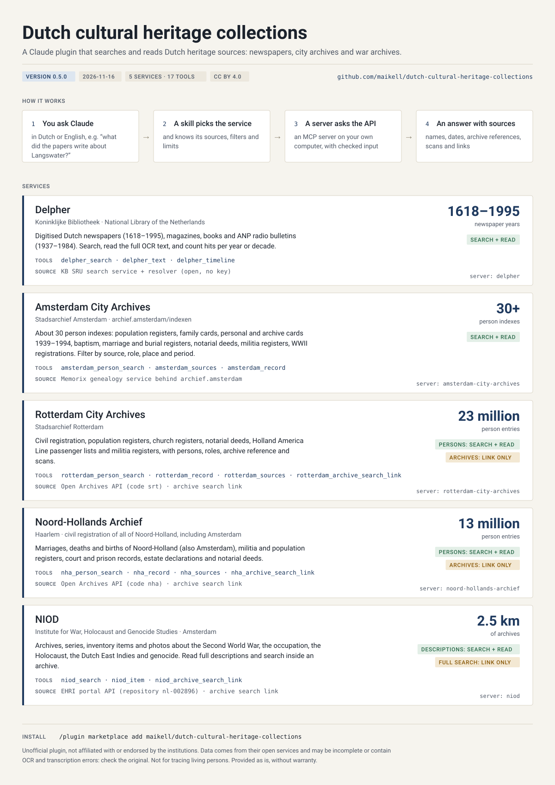

# Dutch cultural heritage collections

**Version 0.5.0** (2026-11-16) · [Changelog](CHANGELOG.md) · [License: CC BY 4.0](LICENSE) · [Disclaimer](#disclaimer)



Claude plugin for searching and reading Dutch cultural heritage collections: digitised newspapers, books, magazines, archives and image banks from Dutch libraries, archives and museums (GLAM institutions). Each collection is a separate service with its own MCP server in `mcp/` and its own skill in `skills/`.

## Install

```
/plugin marketplace add maikell/dutch-cultural-heritage-collections
/plugin install dutch-cultural-heritage-collections@dutch-cultural-heritage-collections
```

Or download the repository as a ZIP and add it as a plugin in Claude.

## Services

More collections will follow, such as the image bank of the Amsterdam City Archives (beeldbank).


| Service | MCP server | Tools | Source |
|---------|-----------|-------|--------|
| Delpher (KB) | `delpher` | `delpher_search`, `delpher_text`, `delpher_timeline` | KB SRU search service `jsru.kb.nl` and resolver `resolver.kb.nl` (open, no key) |
| Amsterdam City Archives (Stadsarchief Amsterdam) | `amsterdam-city-archives` | `amsterdam_person_search`, `amsterdam_sources`, `amsterdam_record` | Memorix genealogy service behind `archief.amsterdam/indexen` |
| Rotterdam City Archives (Stadsarchief Rotterdam) | `rotterdam-city-archives` | `rotterdam_person_search`, `rotterdam_record`, `rotterdam_sources`, `rotterdam_archive_search_link` | Open Archives API `api.openarchieven.nl` (archive code `srt`) and search links for `stadsarchief.rotterdam.nl` |
| Noord-Hollands Archief | `noord-hollands-archief` | `nha_person_search`, `nha_record`, `nha_sources`, `nha_archive_search_link` | Open Archives API (archive code `nha`) and search links for `noord-hollandsarchief.nl` |
| NIOD Institute for War, Holocaust and Genocide Studies | `niod` | `niod_search`, `niod_item`, `niod_archive_search_link` | EHRI portal API `portal.ehri-project.eu/api/v1` (repository `nl-002896`) and search links for `archieven.nl/mi/298` |

### Delpher

Delpher is the Dutch national platform for digitised historical texts, run by the Koninklijke Bibliotheek (KB, National Library of the Netherlands).

- **delpher_search**: search newspapers (1618-1995), magazines, books and ANP radio bulletins (1937-1984), with filters for period, newspaper, type (article, advertisement, family notice, illustration) and sort order (relevance, oldest, newest).
- **delpher_text**: the full OCR text of a newspaper article or radio bulletin, or of one page of a book or magazine.
- **delpher_timeline**: the number of hits per year or per decade.

Limitations: protected texts (copyright) can only be read on Delpher or in the KB reading room; for magazines, books and radio bulletins the search service holds only part of what delpher.nl shows. See the KB terms of use for large-scale reuse (dataservices@kb.nl).

### Amsterdam City Archives

The person indexes of Stadsarchief Amsterdam (archief.amsterdam/indexen): about 30 sources with tens of millions of person entries, including population registers, family cards (gezinskaarten 1893-1939), personal and archive cards (persoonskaarten and archiefkaarten 1939-1994), baptism, marriage and burial registers, notarial deeds, militia registers and WWII registrations.

- **amsterdam_person_search**: search by name, with filters for source, role, place and period.
- **amsterdam_sources**: hit counts per source for a name.
- **amsterdam_record**: one record with everyone named in it, the archive reference and public scans.

The server uses the public key that archief.amsterdam publishes in its own search page. To use a key of your own, set the environment variable `AMSTERDAM_MEMORIX_KEY`. Scans of cards of persons born less than 100 years ago are not public.

### Rotterdam City Archives

- **rotterdam_person_search** and **rotterdam_record**: about 23 million person entries from the open data of Stadsarchief Rotterdam (civil registration, population registers, church registers, notarial deeds, Holland America Line passenger lists, militia registers), through the free Open Archives API (4 requests per second).
- **rotterdam_sources**: source types and counts.
- **rotterdam_archive_search_link**: a search link for the archives and inventories on stadsarchief.rotterdam.nl. That site blocks automated requests, so the results have to be opened in a browser.

### Noord-Hollands Archief

- **nha_person_search** and **nha_record**: about 13 million person entries from the open data of the Noord-Hollands Archief, including the civil registration of all of Noord-Holland (also the marriages and deaths of Amsterdam), militia and population registers, court and prison records and estate declarations, through the Open Archives API.
- **nha_sources**: source types and counts.
- **nha_archive_search_link**: a search link for the archives and inventories on noord-hollandsarchief.nl, to open in a browser.

The Rotterdam and Noord-Holland services run on one script, `mcp/open_archives_mcp.ps1`, started with `-Archive srt` or `-Archive nha`. Another archive in the Open Archives API can be added with one entry in its configuration table.

### NIOD

- **niod_search** and **niod_item**: archive descriptions, series, inventory items and photos of the NIOD Institute for War, Holocaust and Genocide Studies, through the open API of the EHRI portal (European Holocaust Research Infrastructure).
- **niod_archive_search_link**: a search link for the NIOD's own search on archieven.nl, to open in a browser.

## Requirements

Windows with Windows PowerShell 5.1 (installed by default) or PowerShell 7. No extra packages needed.

## Adding a service

1. Add a server as `mcp/<service>_mcp.ps1` (same structure as `delpher_mcp.ps1`: JSON-RPC over stdio, validated input, clear error messages).
2. Register it in `.mcp.json`.
3. Write `skills/<service>/SKILL.md`.
4. Update the table above, `CHANGELOG.md`, the infographic (`docs/infographic.svg`) and the version in `.claude-plugin/plugin.json`, `.claude-plugin/marketplace.json` and at the top of this README.

## Versions

Every release on GitHub gets a new version number (semantic versioning: MAJOR.MINOR.PATCH), an entry in `CHANGELOG.md`, an updated infographic and a matching tag and release (`v0.5.0`).

## Disclaimer

- **Unofficial.** This plugin is an independent project. It is not made, endorsed or supported by the Koninklijke Bibliotheek, Stadsarchief Amsterdam, Stadsarchief Rotterdam, Noord-Hollands Archief, NIOD, EHRI or Open Archives. Their names are used only to describe which sources the plugin searches.
- **Third-party data.** All results come live from the open services of these institutions. They can be incomplete, out of date or wrong: OCR text and index transcriptions contain errors, and not every source is digitised or indexed. Always check the original record or scan before you rely on it or quote it.
- **Availability.** The plugin depends on services it does not control. A service can be slow, unavailable or changed at any time, and the plugin can then return errors or fewer results. Archive search links only open the institutions' own websites.
- **Keys and terms.** The Amsterdam service uses the public key that archief.amsterdam publishes in its own search page; set `AMSTERDAM_MEMORIX_KEY` to use your own. Use each service within its own terms of use and rate limits, and contact the institution before reusing data at scale.
- **Privacy.** Archives contain personal data, including data about people who may still be alive and about sensitive histories (war, persecution, court and prison records, patients' registers). Use the plugin for historical and genealogical research. Do not use it to trace, locate or profile living private persons, and comply with the GDPR (AVG) when you process personal data from the results.
- **No advice, no warranty.** Answers are generated by an AI model from the retrieved records and can contain mistakes. They are not legal, genealogical or professional advice. The plugin is provided "as is", without warranty of any kind, as stated in the CC BY 4.0 license; the authors are not liable for any use of it or of the data it returns.

## License

This plugin is licensed under the [Creative Commons Attribution 4.0 International License (CC BY 4.0)](https://creativecommons.org/licenses/by/4.0/). See `LICENSE`. Data, texts and images retrieved from the services remain subject to the terms of the institutions (KB, Stadsarchief Amsterdam, Stadsarchief Rotterdam, Noord-Hollands Archief, NIOD, EHRI, Open Archives) and the rights holders.
